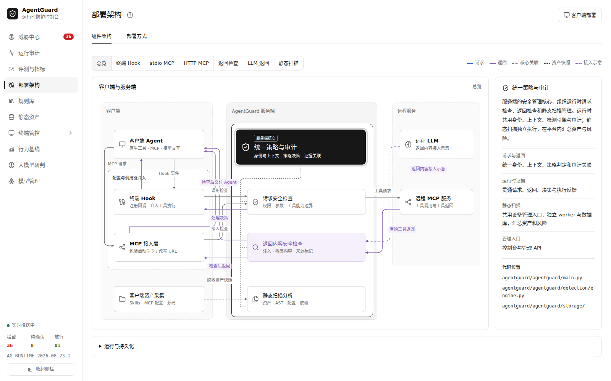
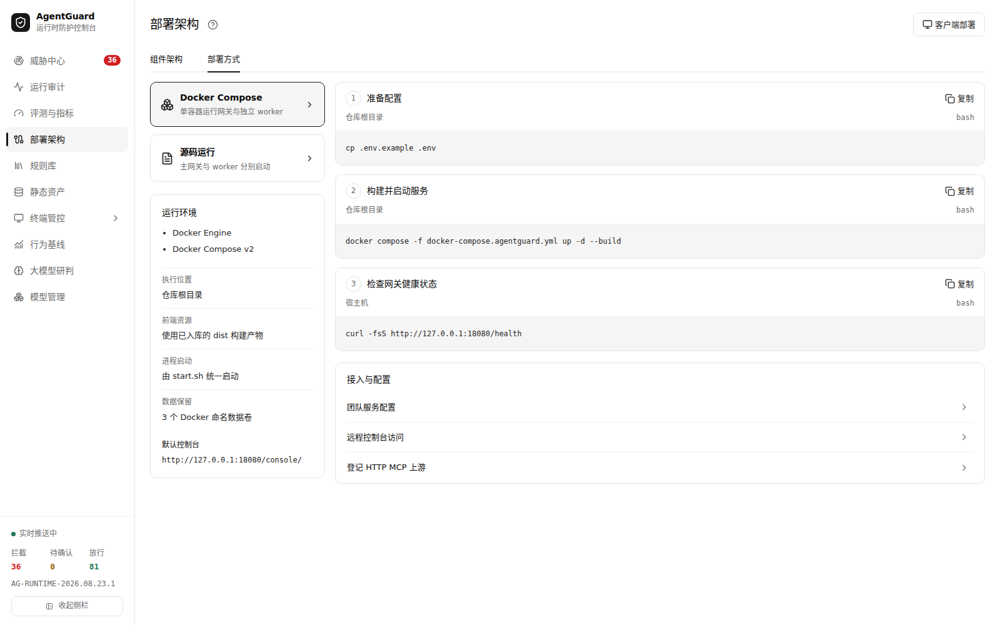
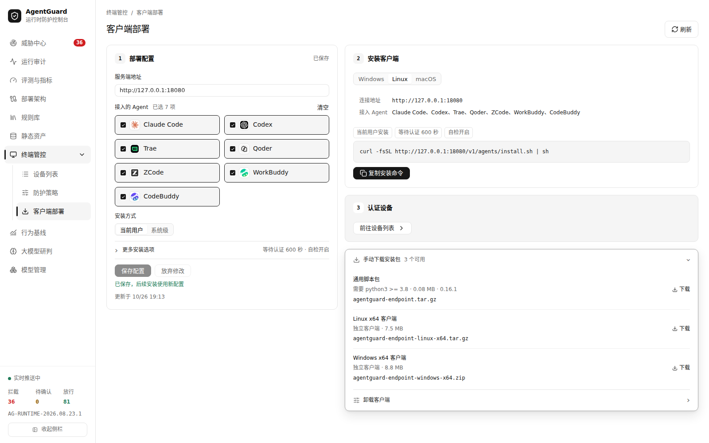

# AgentGuard 部署指南

本文说明 AgentGuard 服务端的部署形态、配置、访问、升级与数据保留，以及控制台的终端客户端分发。各 Agent 的 Hook 安装、MCP 中转、自检和卸载见 [终端接入说明](../agentguard/endpoint/README.md)；Python / 前端源码开发见 [README 的本地开发运行](../README.md#7-本地开发运行)。

## 1. 部署形态

AgentGuard 以单个 Compose 服务运行。容器内同时包含：

- **主网关**：Hook API、MCP 强制代理、管理接口、检测引擎和运行时审计库，监听 `8080`；
- **静态扫描 worker**：独立进程，异常退出由守护循环重启，不阻塞网关；
- **评测 worker**：`AG_LOCAL_TEST=1` 或配置 `AG_EVAL_ADMIN_TOKEN` 时启用；
- **控制台静态资源**：Vite 构建产物 `console/dist`，运行时不需要 Node.js；
- **SQLite 数据**：运行时审计、静态扫描和评测结果分别落在三个命名卷中。



*图：控制台「部署架构 → 组件架构」，展示客户端、Hook、MCP 接入、请求检查、返回检查、静态扫描与远程服务的关系。*

终端 Agent 通过 Hook 或 MCP 接入；需要本地快速判定时安装终端客户端。终端只承担服务端必然拒绝的高置信场景，跨事件、跨会话的权威判定都在网关侧完成。

## 2. 环境准备

Docker 部署需要 Git、Docker Engine 和 Docker Compose v2；首次构建需联网安装依赖。仓库已包含前端构建产物，运行时无需 Node.js 或 GPU。

```bash
git clone https://github.com/HelloSHANGCY/AgentGuardOpen.git
cd AgentGuardOpen
```

Linux、macOS 或 Windows WSL2 / Docker Desktop Linux 容器环境可使用以下命令。

## 3. 首次部署

```bash
cp .env.example .env
docker compose -f docker-compose.agentguard.yml config -q
make up
make smoke
```

打开 **<http://127.0.0.1:18080/console/>**。`make smoke` 请求 `/health`，返回 `{"status":"ok"}` 即表示网关已启动。

控制台「部署架构」展示组件和调用链路；「部署方式」提供 Docker Compose、源码运行和相关接入配置，可逐项复制命令。原 `#/range` 书签会转到 `#/deployment`。



*图：控制台「部署架构 → 部署方式」，Docker Compose 的配置、构建、健康检查和团队配置入口。*

### 3.1 访问地址

| 地址 | 用途 |
| --- | --- |
| `http://127.0.0.1:18080/console/` | 控制台 |
| `http://127.0.0.1:18080/health` | 健康检查 |
| `http://127.0.0.1:18080/docs` | API 文档 |

容器内网关端口为 `8080`，宿主机默认仅绑定 `127.0.0.1:18080`。

### 3.2 默认数据卷

| 命名卷 | 容器目录 | 内容 |
| --- | --- | --- |
| `agent-device-data` | `/app/data/agent-devices` | 设备、运行时审计库、规则配置、模型接入配置、行为基线等 |
| `static-scan-data` | `/app/data/static-scan` | 静态扫描数据库 |
| `evaluation-data` | `/app/data/evaluations` | 评测任务与结果 |

Docker 实际卷名还带有 Compose 项目前缀。升级时保持相同的项目目录 / 项目名，否则可能连接到新卷而显示为空。

## 4. 团队部署配置

默认配置面向本机开发，`AG_LOCAL_TEST=1` 且管理令牌留空时，部分管理操作免令牌。团队部署在 `.env` 中配置：

```dotenv
AG_LOCAL_TEST=0
AG_HOOK_SECRET=替换为独立生成的随机长字符串
AG_AGENT_ADMIN_TOKEN=替换为独立生成的管理令牌
AG_EVAL_ADMIN_TOKEN=替换为独立生成的评测管理令牌
```

`.env` 被 Git 忽略。设备、规则和模型页面使用 `AG_AGENT_ADMIN_TOKEN`，评测页面使用 `AG_EVAL_ADMIN_TOKEN`；页面刷新后需重新输入。静态扫描专用令牌留空时回退到统一管理鉴权。

修改 `.env` 后需要重新创建容器：

```bash
docker compose -f docker-compose.agentguard.yml up -d
```

单纯 `restart` 不会更新容器环境变量。

### 4.1 HTTP MCP 上游

HTTP MCP 上游默认为空。需要转发时，由管理员在 `.env` 中登记，再重新创建容器：

```dotenv
AG_EXTRA_UPSTREAMS={"docs":"http://your-mcp-host:8000/mcp"}
```

客户端使用 `/mcp/docs` 访问该上游；请求参数不能指定任意转发地址。

### 4.2 静态扫描目录

静态扫描远程项目时，应自行只读挂载目录，并配置 `AG_STATIC_SOURCES`、`AG_STATIC_ROOTS` 指向容器内实际路径。终端本地扫描也可通过设备接入使用，具体见 [终端接入说明](../agentguard/endpoint/README.md)。

## 5. 终端客户端部署

终端客户端用控制台的「终端管控 → 客户端部署」统一配置和分发。页面可以设置终端访问服务端的地址、需要接入的 Agent、安装范围、等待认证时间和安装后自检；配置保存后，安装命令和下载包立即按新配置生成。


*图：控制台「终端管控 → 客户端部署」，设置服务端地址、Agent 和安装方式，并生成一键安装命令。*

常用流程：

1. 在「服务端地址」填写终端实际可达的地址；留空时使用控制台当前地址。
2. 勾选需要接入的 Agent。Linux / macOS 默认使用通用脚本包，要求 Python 3.8+；Windows 使用预构建 exe 包。
3. 选择「当前用户」或「系统级」安装，按需调整等待认证时间与安装后自检。
4. 保存配置，复制页面生成的安装命令到目标终端执行。未携带预签发令牌时，终端会自动提交接入申请。
5. 管理员在「终端管控 → 设备列表」核对核对码并认证；认证后 Hook 生效。

「安装客户端」区域提供 Windows / Linux / macOS 切换和对应的一键安装命令。Windows 需要服务端已发布 Windows 客户端包，否则页面会提示未发布。Linux / macOS 在存在预构建包时优先使用二进制，否则回退到 Python 脚本包。

### 5.1 手动下载安装包

展开「手动下载安装包」可以查看服务端当前提供的所有客户端：



*图：通用脚本包、Linux x64 和 Windows x64 客户端。预构建包位于 `endpoint/dist/`，重建服务端镜像后由 `/v1/agents/client` 提供下载。*

| 包 | 适用平台 | 要求 |
| --- | --- | --- |
| `agentguard-endpoint.tar.gz` | Linux / macOS 脚本包 | Python 3.8+ |
| `agentguard-endpoint-linux-x64.tar.gz` | Linux x64 二进制 | glibc 2.31+ |
| `agentguard-endpoint-windows-x64.zip` | Windows x64 exe | 无需 Python |

各 Agent 的 Hook 安装、MCP 中转、自检、升级和卸载命令见 [终端接入说明](../agentguard/endpoint/README.md)。预构建包不随 Git 分发；需要从服务端下载时，先按构建脚本生成 `endpoint/dist/` 产物，再重建 AgentGuard 镜像。

## 6. 访问地址与远程部署

远程访问可使用 SSH 隧道：

```bash
ssh -N -L 18080:127.0.0.1:18080 user@server
```

局域网部署时，将端口映射改为受控网卡地址，并在「客户端部署」中填写终端实际可达的服务地址。运行时审计查询接口目前没有统一令牌鉴权，跨不可信网络访问需配置 HTTPS 和外层访问控制。

## 7. 日常维护、升级与数据保留

```bash
# 查看日志
docker compose -f docker-compose.agentguard.yml logs --tail 100 -f agentguard

# 停止 / 恢复已有容器
docker compose -f docker-compose.agentguard.yml stop
docker compose -f docker-compose.agentguard.yml start

# 拉取更新后重新构建（先处理本地未提交改动）
git pull --ff-only
docker compose -f docker-compose.agentguard.yml up -d --build
```

运行时审计默认保留最近 7 天，可通过 `AG_RUNTIME_RETENTION_DAYS` 调整。

`make down` 停止并移除服务容器，保留命名数据卷。迁移时停止写入后备份数据卷及 `.env`；需要清空数据时再显式使用：

```bash
docker compose -f docker-compose.agentguard.yml down -v
```

## 8. 部署排查

| 现象 | 排查方法 |
| --- | --- |
| 控制台打不开 | 检查 `docker compose ... ps` 和日志；Docker 宿主机访问 `18080`，本地 Python 服务才使用 `8080`；远程访问需隧道或可达的网卡绑定。 |
| 启动提示端口占用 | 检查是否已有服务占用 `18080`；调整端口映射时同步修改终端服务地址。 |
| 构建失败或一直下载 | 查看构建日志，检查 Docker 镜像源、容器构建网络和 Python 包源。 |
| 管理接口返回 401 / 503 | 401 通常是令牌缺失或错误；关闭本地测试后未设置所需管理令牌会返回 503。修改 `.env` 后执行 `up -d`，单纯 `restart` 不会更新容器环境变量。 |
| 容器中模型连接失败 | 检查完整接口地址、密钥、超时与容器网络；模型服务在宿主机时不能直接填容器的 `localhost`。 |
| Windows 客户端下载 404 | 先构建 Windows 客户端包并重建服务镜像；预构建包没有随 Git 分发。 |
| 前端改动没有生效 | 执行 `npm run build` 后重建并更新 `agentguard` 容器，再刷新浏览器。 |

## 9. 相关文档

- [终端接入、MCP 中转、客户端构建与卸载](../agentguard/endpoint/README.md)
- [本地开发运行](../README.md#7-本地开发运行)
- [固定离线测试数据说明](../agentguard/resources/testing/range-v1/README.md)
- [共享行为基线资源说明](../agentguard/resources/behavior/README.md)
